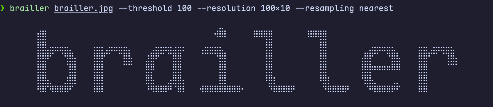

# Brailler — Braille Art Generator



---

**Brailler** is a command-line utility written in Python that converts any image into Braille-based text arts. (like ASCII art)

Each Braille character contains up to 8 dots, allowing for a higher "resolution" compared to standard ASCII art. This makes brailler much better for creating detailed text-based graphics.


## Features
- Converts PNG/JPG images into Braille-based art (transparency is ignored)
- Adjustable output size
- Configurable dithering algorithm and binarization threshold
- Color inversion


## Installation
Install from github using pip/pipx
```bash
pipx install git+https://github.com/wandderq/brailler@main
```

## Usage
### Basic example
```bash
brailler input.jpg
```

### Specify output size
```bash
brailler input.jpg --resolution 100x50
```

### Adjust binarization threshold
```bash
brailler input.jpg --threshold 222 
```

### Enable Floyd-Steinberg dithering
```bash
brailler input.jpg --dither floydsteinberg
```

### As a library
```python
from brailler import BrailleArtGenerator, Dither
from PIL.Image import Resampling

generator = BrailleArtGenerator("/path/to/picture.jpg")

art = generator.generate(
    resolution=(100, 50),
    dither=Dither.ATKINSON,
    resampling=Resampling.BICUBIC
    threshold=220,
    invert=False,
)

print(art)
```

## Command-line arguments
| Argument           | Description                                                 |
|--------------------|-------------------------------------------------------------|
| `input`            | input image file path        |
| `-r, --resolution` | output resolution characters |
| `-t, --threshold`  | binarization threshold       |
| `-R, --resampling` | resampling algorithm         |
| `-d, --dither`     | dithering algorithm          |
| `-i, --invert`     | invert image colors          |
| `-v, --verbose`    | verbose mode (INFO logs)     |
| `--debug`          | debug features               |


## Requirements
- `Python >= 3.12`
- `pillow >= 12.1.10`
- `colorlog >= 6.10.1`

See [pyproject.toml](https://github.com/wandderq/brailler/blob/main/pyproject.toml) for more details


## License
This project is licensed under the MIT License. See the [LICENSE.md](https://github.com/wandderq/brailler/blob/main/LICENSE.md) file for details (tl;dr do whatever you want but keep the original copyright)

